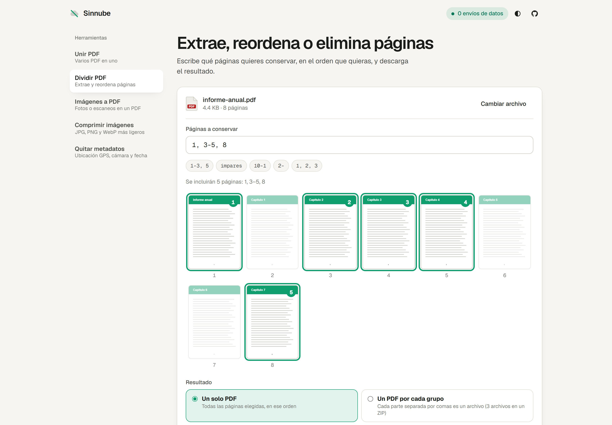
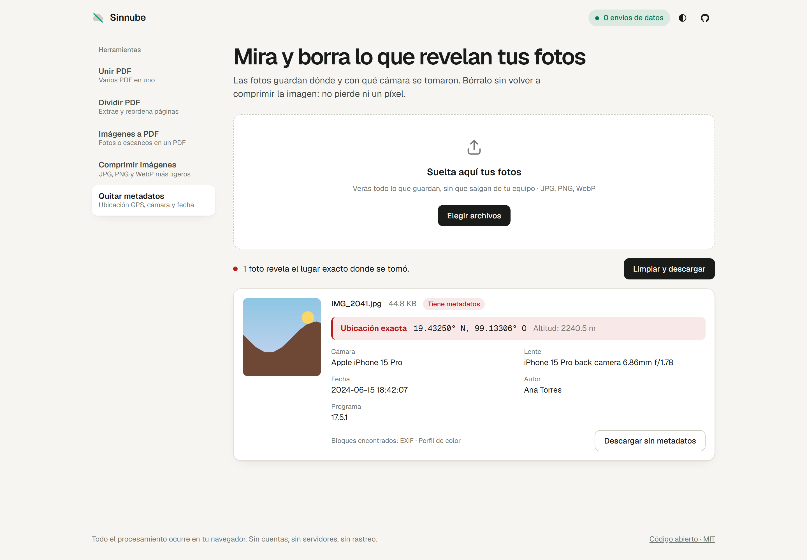
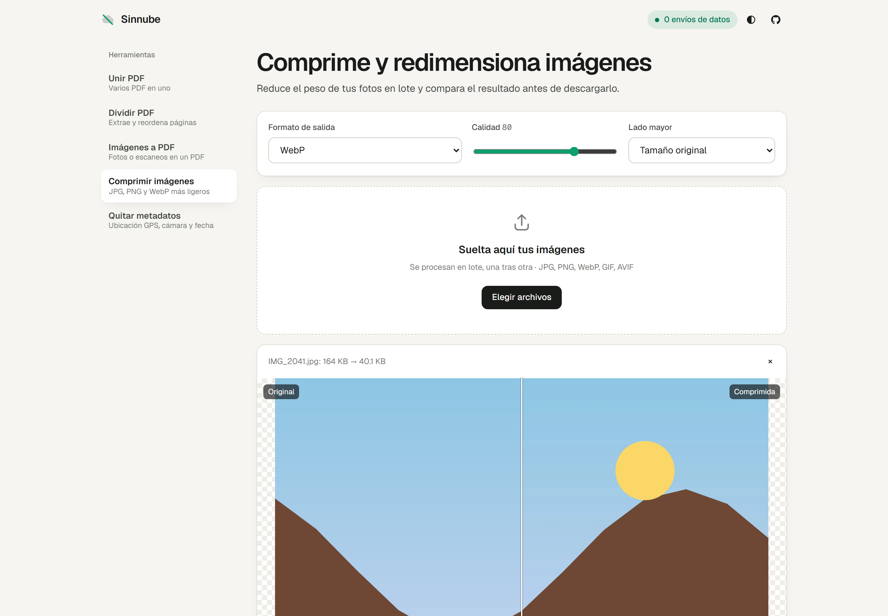

# Sinnube

**Herramientas de PDF e imágenes que funcionan 100 % en tu navegador.** Tus archivos nunca suben a ninguna nube.

🔗 **Demo:** https://christianivandev.github.io/sinnube/

<a href="https://christianivandev.github.io/sinnube/#/dividir">
  <picture>
    <source media="(prefers-color-scheme: dark)" srcset="docs/dividir-oscuro.png">
    
  </picture>
</a>

## Por qué

Los sitios para «unir PDF gratis» suben tus documentos a un servidor ajeno: contratos, identificaciones, estados de cuenta. Sinnube hace lo mismo sin conexión. Todo el código corre en tu navegador y la propia app lo demuestra: un indicador cuenta cada petición de red desde que agregas un archivo (siempre cero envíos de datos), y después de la primera visita funciona sin internet.

## Herramientas

| Herramienta | Qué hace |
|---|---|
| **Unir PDF** | Junta varios PDF en el orden que elijas, sin rasterizar: conserva texto, enlaces y calidad |
| **Dividir PDF** | Extrae y reordena páginas con miniaturas o escribiendo rangos («1-3, 5», «8-», «10-1», «impares»); puede generar un PDF por grupo en un ZIP |
| **Imágenes a PDF** | Una foto por página en A4, Carta u Oficio; gira las páginas apaisadas |
| **Comprimir imágenes** | WebP, JPG, PNG o AVIF con calidad y tamaño ajustables, comparador antes/después y procesamiento en paralelo |
| **Quitar metadatos** | Muestra la ubicación GPS, la cámara y la fecha de tus fotos y las borra sin volver a comprimir la imagen |

<picture>
  <source media="(prefers-color-scheme: dark)" srcset="docs/metadatos-oscuro.png">
  
</picture>

<picture>
  <source media="(prefers-color-scheme: dark)" srcset="docs/comprimir-oscuro.png">
  
</picture>

## Decisiones técnicas

### Formatos implementados a mano
Para demostrar que entiendo los formatos y no solo las librerías, lo que es pequeño y bien especificado lo escribí desde cero, con tests byte a byte:

- **Lector de EXIF** (`src/lib/exif.ts`): interpreta el TIFF interno en ambos órdenes de bytes (`II` y `MM`) dentro de JPG (APP1), PNG (`eXIf`) y WebP (RIFF). Extrae GPS, cámara, lente, fechas y autor, y detecta XMP, IPTC, comentarios y textos de PNG. No falla con archivos truncados.
- **Limpieza sin pérdida** (`src/lib/strip.ts`): elimina los bloques de metadatos y copia los datos de la imagen tal cual. Conserva el perfil de color y reescribe la orientación en un EXIF mínimo de 36 bytes, porque sin ella las fotos verticales aparecerían giradas. En WebP apaga las banderas de `VP8X` y recalcula el tamaño del contenedor.
- **Generador de ZIP** (`src/lib/zip.ts`): formato PKWARE con CRC-32, nombres UTF-8 y nombres repetidos resueltos. Usa el método «store»: PDF y fotos ya vienen comprimidos, así que comprimir otra vez cuesta tiempo y casi no ahorra.
- **Detección del tipo real** (`src/lib/sniff.ts`): por la firma de bytes, no por la extensión. Un texto renombrado a `.pdf` se rechaza.
- **Rangos de páginas** (`src/lib/ranges.ts`): entiende cómo escribe una persona: guiones largos de Word, rangos abiertos, orden inverso y palabras como «impares» o «última».

### Rendimiento
- **Web Workers con OffscreenCanvas**: la compresión corre en hasta 4 hilos y la interfaz no se congela con lotes grandes. Si cambias los ajustes a mitad de un lote, la pasada anterior se cancela.
- **pdf.js bajo demanda**: pesa ~1 MB, así que solo se descarga la primera vez que abres un PDF. Cada miniatura se dibuja cuando entra en pantalla (`IntersectionObserver`).

### Privacidad comprobable
- `src/lib/network.ts` observa la API Resource Timing y distingue los **envíos de datos** (fetch, XHR, beacon) de las **descargas de código** de la propia app.
- Al convertir imágenes a PDF, los JPG se incrustan sin recomprimir **y sin sus metadatos**: el GPS no queda escondido dentro del PDF. Un test lo comprueba.
- El service worker guarda la app para usarla sin conexión: la página se pide primero a la red y, si no hay, se sirve la última guardada.

## Estructura

```
src/
├── lib/            # Lógica pura, con tests
│   ├── exif.ts · strip.ts     # Metadatos: leer y eliminar
│   ├── pdf.ts · ranges.ts     # Unir y dividir PDF
│   ├── image.ts · imageWorker.ts · concurrency.ts
│   ├── imagesToPdf.ts · layout.ts
│   ├── zip.ts · sniff.ts · network.ts · format.ts
│   └── testing/fixtures.ts    # JPG, PNG y WebP de prueba construidos byte a byte
├── workers/compress.worker.ts
├── components/     # FileDrop, PageGrid, PrivacyBadge, Toaster
└── tools/          # Una pantalla por herramienta
```

## Desarrollo

```bash
npm install
npm run dev          # servidor local
npm test             # tests con Vitest
npm run typecheck    # TypeScript estricto
npm run build        # build de producción
npm run screenshots  # regenera las capturas del README (con npm run dev activo)
```

Cada push a `main` pasa por GitHub Actions (tipos, tests y build) y se publica en GitHub Pages.

## Stack

React 18 · TypeScript (estricto) · Vite · Vitest · pdf-lib · pdf.js · Web Workers · Service Worker · GitHub Actions

---

Hecho por [Christian Ivan Espinoza Gaytan](https://github.com/ChristianIvanDev). Licencia MIT.
